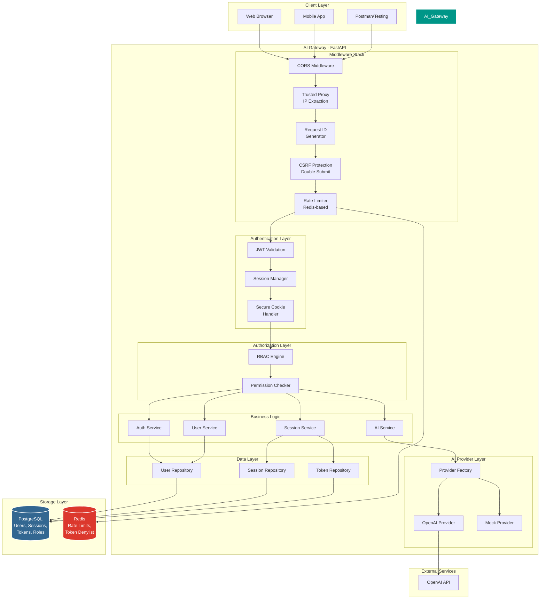
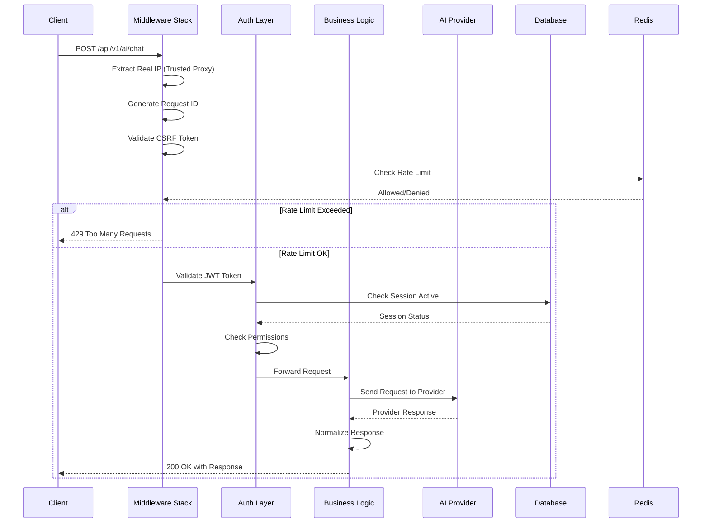
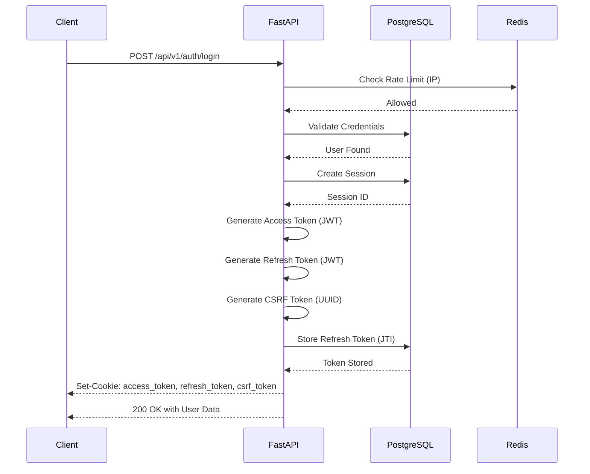
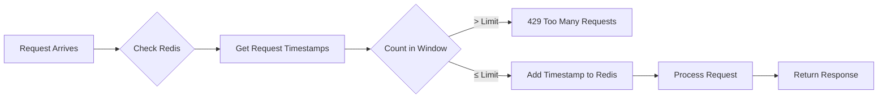

# 🚀 Enterprise AI Gateway

<div align="center">


**یک AI Gateway امن، مقیاس‌پذیر و حرفه‌ای برای مدیریت درخواست‌های هوش مصنوعی**

[گزارش تست‌ها](docs/test_results/) • [مستندات API](http://127.0.0.1:8000/docs) • [دمو Rate Limiting](docs/rate_limit_login_demo.mp4)

</div>

---

## 📋 فهرست مطالب

- [معرفی پروژه](#-معرفی-پروژه)
- [نقشه معماری کامل](#-نقشه-معماری-کامل)
- [ویژگی‌های کلیدی](#-ویژگی‌های-کلیدی)
- [سیستم احراز هویت](#-سیستم-احراز-هویت)
- [مکانیزم Rate Limiting](#-مکانیزم-rate-limiting)
- [ساختار پروژه](#-ساختار-پروژه)
- [دستورات راه‌اندازی](#-دستورات-راه‌اندازی)
- [مدیریت پکیج با uv](#-مدیریت-پکیج-با-uv)
- [API Endpoints](#-api-endpoints)
- [تست‌ها و QA](#-تست‌ها-و-qa)
- [امنیت](#-امنیت)
- [مستندات](#-مستندات)

---

## 🎯 معرفی پروژه

این پروژه یک **AI Gateway** حرفه‌ای است که به عنوان لایه میانی بین کلاینت و ارائه‌دهندگان سرویس‌های هوش مصنوعی (مانند OpenAI) قرار می‌گیرد. هدف اصلی این پروژه:

- **مدیریت متمرکز API Keyها**: کلاینت هرگز به API Keyهای Providerها دسترسی ندارد
- **امنیت سطح Enterprise**: پیاده‌سازی JWT، CSRF Protection، Rate Limiting و Session Management
- **مقیاس‌پذیری**: معماری ماژولار برای اضافه کردن Providerهای جدید بدون تغییر در کد
- **Observability**: Logging ساختاریافته و Request Tracking

---

## 🗺️ نقشه معماری کامل

### نمای کلی سیستم



### جریان درخواست (Request Flow)



---

## ✨ ویژگی‌های کلیدی

### 🔐 امنیت و احراز هویت
- **JWT با چرخش امن**: Access Token (15 دقیقه) + Refresh Token (7 روز) با Rotation
- **CSRF Protection**: الگوی Double Submit Cookie برای جلوگیری از حملات CSRF
- **Secure Cookies**: HttpOnly, Secure, SameSite=Lax برای تمام توکن‌ها
- **Session Management**: ردیابی User-Agent، IP Hash، و قابلیت Revoke
- **Rate Limiting**: محدودسازی نرخ درخواست بر اساس IP و User با Redis

### 🏗️ معماری
- **Clean Architecture**: جداسازی Router, Service, Repository
- **Provider Abstraction**: لایه انتزاعی برای اضافه کردن Providerهای جدید
- **Async First**: استفاده بهینه از Async/Await در تمام لایه‌ها
- **Dependency Injection**: مدیریت وابستگی‌ها با FastAPI DI

### 🐳 زیرساخت
- **Dockerized**: محیط‌های Development, Testing, Production ایزوله
- **uv Package Manager**: مدیریت سریع و مدرن وابستگی‌ها
- **Alembic Migrations**: مدیریت نسخه‌بندی دیتابیس
- **Hot Reload**: تغییرات کد بلافاصله اعمال می‌شوند (Development)

---

## 🔑 سیستم احراز هویت

### انواع احراز هویت پیاده‌سازی شده

#### 1. JWT Authentication (Access Token)
```http
Cookie: access_token=eyJhbGciOiJIUzI1NiIsInR5cCI6IkpXVCJ9...
```
- **مدت اعتبار**: 15 دقیقه
- **الگوریتم**: HS256
- **Claims**: sub, sid, type, jti, iat, nbf, exp, role, csrf
- **ویژگی‌ها**:
  - Stateless (بدون نیاز به Database برای Validation)
  - شامل Session ID برای ردیابی
  - شامل CSRF Token برای محافظت

#### 2. Refresh Token
```http
Cookie: refresh_token=eyJhbGciOiJIUzI1NiIsInR5cCI6IkpXVCJ9...
```
- **مدت اعتبار**: 7 روز
- **ذخیره‌سازی**: Database (برای Revocation)
- **ویژگی‌ها**:
  - **Rotation**: هر بار استفاده، توکن جدید صادر می‌شود
  - **Replay Detection**: استفاده مجدد از توکن قدیمی = Revoke کل Session
  - **JTI**: شناسه یکتا برای هر توکن

#### 3. Session-Based Authentication
```http
Cookie: access_token=...; refresh_token=...; csrf_token=...
```
- **Session Tracking**:
  - User-Agent
  - IP Hash (SHA-256)
  - Created At
  - Last Used At
  - Is Active

#### 4. CSRF Protection (Double Submit Cookie)
```http
Cookie: csrf_token=abc123...
Header: X-CSRF-Token: abc123...
```
- **الگوریتم**: UUID v4
- **مدت اعتبار**: 1 ساعت
- **ویژگی‌ها**:
  - Cookie غیر HttpOnly (قابل خواندن توسط JavaScript)
  - Header در تمام درخواست‌های State-Changing (POST, PUT, DELETE)
  - مقایسه مقدار Cookie با Header

### جریان کامل Login



---

## 🚦 مکانیزم Rate Limiting

### الگوریتم: Sliding Window Log



### محدودیت‌های تعریف شده

| Endpoint | Limit | Window | Scope |
|----------|-------|--------|-------|
| `/api/v1/auth/login` | 5 | 1 دقیقه | IP |
| `/api/v1/auth/register` | 3 | 1 دقیقه | IP |
| `/api/v1/ai/chat` | 20 | 1 دقیقه | IP + User |
| `/api/v1/ai/generate` | 10 | 1 دقیقه | IP + User |
| سایر Endpoints | 100 | 1 دقیقه | IP |

### مثال عملی: Rate Limit در Login

**سناریو**: کاربر سعی می‌کند 6 بار در 1 دقیقه لاگین کند
<div align="ltr">
```bash
# درخواست 1-5: موفق
POST /api/v1/auth/login
Response: 200 OK

# درخواست 6: مسدود شده
POST /api/v1/auth/login
Response: 429 Too Many Requests
{
  "success": false,
  "error": {
    "code": "RATE_LIMIT_EXCEEDED",
    "message": "Too many login attempts. Please try again later.",
    "details": {
      "limit": 5,
      "window": "1 minute",
      "retry_after": 45
    }
  }
}

</div>
```

📺 **[مشاهده ویدئوی دمو: Rate Limiting در عمل](docs/rate_limit_login_demo.mp4)**

---

## 📁 ساختار پروژه

```
ai-gateway/
├── app/                          # کد اصلی برنامه
│   ├── api/                      # لایه API
│   │   ├── dependencies/         # FastAPI Dependencies
│   │   │   ├── auth.py           # Authentication Dependencies
│   │   │   ├── db.py             # Database Session
│   │   │   ├── rate_limit.py     # Rate Limiting
│   │   │   └── services.py       # Service Injection
│   │   ├── middleware/           # Middlewareها
│   │   │   ├── csrf.py           # CSRF Protection
│   │   │   ├── request_id.py     # Request ID Generator
│   │   │   └── trusted_proxy.py  # IP Extraction
│   │   └── v1/                   # API Version 1
│   │       ├── routers/          # Endpoint Routers
│   │       │   ├── auth.py       # Authentication Endpoints
│   │       │   ├── users.py      # User Endpoints
│   │       │   ├── sessions.py   # Session Endpoints
│   │       │   └── ai.py         # AI Endpoints
│   │       └── router.py         # Main Router
│   │
│   ├── core/                     # هسته برنامه
│   │   ├── config/               # Configuration
│   │   │   └── settings.py       # Pydantic Settings
│   │   ├── security/             # Security Utilities
│   │   │   ├── jwt.py            # JWT Operations
│   │   │   ├── password.py       # Password Hashing
│   │   │   └── csrf.py           # CSRF Token
│   │   ├── exceptions/           # Custom Exceptions
│   │   │   ├── auth.py           # Auth Exceptions
│   │   │   ├── ai.py             # AI Exceptions
│   │   │   └── rate_limit.py     # Rate Limit Exceptions
│   │   ├── logging/              # Logging Configuration
│   │   │   └── config.py         # Structured Logging
│   │   └── redis/                # Redis Client
│   │       └── client.py         # Redis Connection
│   │
│   ├── models/                   # SQLAlchemy Models
│   │   ├── user.py               # User Model
│   │   ├── session.py            # Session Model
│   │   ├── refresh_token.py      # Refresh Token Model
│   │   ├── role.py               # Role Model
│   │   └── permission.py         # Permission Model
│   │
│   ├── schemas/                  # Pydantic Schemas
│   │   ├── auth.py               # Auth Schemas
│   │   ├── user.py               # User Schemas
│   │   ├── session.py            # Session Schemas
│   │   └── ai.py                 # AI Schemas
│   │
│   ├── repositories/             # Data Access Layer
│   │   ├── base.py               # Base Repository
│   │   ├── user.py               # User Repository
│   │   ├── session.py            # Session Repository
│   │   └── refresh_token.py      # Token Repository
│   │
│   ├── services/                 # Business Logic Layer
│   │   ├── auth.py               # Auth Service
│   │   ├── user.py               # User Service
│   │   ├── session.py            # Session Service
│   │   └── ai.py                 # AI Service
│   │
│   ├── ai/                       # AI Provider Layer
│   │   ├── providers/            # Provider Implementations
│   │   │   ├── base.py           # Base Provider Interface
│   │   │   ├── openai.py         # OpenAI Provider
│   │   │   └── mock.py           # Mock Provider (Testing)
│   │   ├── factory.py            # Provider Factory
│   │   └── schemas.py            # AI Schemas
│   │
│   └── main.py                   # FastAPI Application
│
├── alembic/                      # Database Migrations
│   ├── versions/                 # Migration Files
│   └── env.py                    # Alembic Environment
│
├── scripts/                      # Utility Scripts
│   └── seed_roles.py             # Seed Initial Roles
│
├── tests/                        # Test Suite
│   ├── conftest.py               # Pytest Fixtures
│   ├── test_auth.py              # Auth Tests
│   ├── test_session.py           # Session Tests
│   └── test_ai.py                # AI Tests
│
├── docs/                         # Documentation
│   ├── test_results/             # Test Reports
│   ├── screenshots/              # Screenshots
│   └── rate_limit_login_demo.mp4 # Demo Video
│
├── docker/                       # Docker Configuration
│   ├── Dockerfile                # Backend Dockerfile
│   ├── docker-compose.yml        # Main Compose
│   └── docker-compose.override.yml # Dev Overrides
│
├── .env                          # Environment Variables (Not in Git)
├── .env.example                  # Example Environment
├── pyproject.toml                # Python Project Config
├── uv.lock                       # uv Lock File
├── alembic.ini                   # Alembic Config
└── README.md                     # This File
```

---

## 🚀 دستورات راه‌اندازی

### پیش‌نیازها
- Docker Desktop (ویندوز)
- uv (مدیریت پکیج پایتون)
- PowerShell

### 1. کلون کردن پروژه
```powershell
git clone https://github.com/yourusername/ai-gateway.git
cd ai-gateway
```

### 2. نصب وابستگی‌ها با uv
```powershell
# نصب uv (اگر نصب نیست)
pip install uv

# همگام‌سازی وابستگی‌ها
uv sync
```

### 3. تنظیم Environment Variables
```powershell
# کپی فایل نمونه
Copy-Item .env.example .env

# ویرایش فایل .env و تنظیم مقادیر
notepad .env
```

**مقادیر ضروری در `.env`:**
```env
# Database
DB_HOST=localhost
DB_PORT=5432
DB_USER=postgres
DB_PASSWORD=your_secure_password
DB_NAME=ai_gateway

# Redis
REDIS_HOST=localhost
REDIS_PORT=6379

# Security
JWT_SECRET_KEY=your_super_secret_key_here
CSRF_ENABLED=true
CSRF_COOKIE_SECURE=false  # در Development

# AI Provider
OPENAI_API_KEY=sk-your-openai-api-key
```

### 4. راه‌اندازی با Docker Compose
```powershell
# Build و اجرای سرویس‌ها
docker-compose -f docker/docker-compose.yml up -d --build

# بررسی وضعیت کانتینرها
docker-compose -f docker/docker-compose.yml ps
```

### 5. اعمال Migrationهای دیتابیس
```powershell
# ساخت جداول
docker-compose -f docker/docker-compose.yml exec backend uv run alembic upgrade head

# Seed کردن Roleهای اولیه
docker-compose -f docker/docker-compose.yml exec backend uv run python scripts/seed_roles.py
```

### 6. دسترسی به سرویس‌ها
- **API**: http://127.0.0.1:8000
- **Swagger UI**: http://127.0.0.1:8000/docs
- **ReDoc**: http://127.0.0.1:8000/redoc

### دستورات پرکاربرد

```powershell
# مشاهده لاگ‌ها
docker-compose -f docker/docker-compose.yml logs -f backend

# ری‌استارت Backend
docker-compose -f docker/docker-compose.yml restart backend

# ورود به Shell کانتینر
docker-compose -f docker/docker-compose.yml exec backend bash

# اجرای تست‌ها
docker-compose -f docker/docker-compose.yml exec backend uv run pytest -v

# توقف سرویس‌ها
docker-compose -f docker/docker-compose.yml down

# توقف و پاکسازی Volumeها (هشدار: داده‌ها پاک می‌شوند)
docker-compose -f docker/docker-compose.yml down -v
```

---

## 📦 مدیریت پکیج با uv

### چرا uv؟
- **سرعت**: 10-100x سریع‌تر از pip
- **قابلیت اطمینان**: Lock File برای Reproducible Builds
- **مدرن**: پشتیبانی از Pyproject.toml
- **سازگاری**: کاملاً compatible با PyPI

### دستورات uv

```powershell
# همگام‌سازی وابستگی‌ها از pyproject.toml
uv sync

# اضافه کردن پکیج جدید
uv add <package-name>

# حذف پکیج
uv remove <package-name>

# به‌روزرسانی پکیج‌ها
uv lock --upgrade

# اجرای دستور در محیط مجازی
uv run <command>

# مثال: اجرای pytest
uv run pytest -v

# مثال: اجرای alembic
uv run alembic upgrade head
```

### فایل‌های مرتبط
- `pyproject.toml`: تعریف وابستگی‌ها و تنظیمات پروژه
- `uv.lock`: Lock File برای نسخه‌های دقیق پکیج‌ها

---

## 📡 API Endpoints

### Authentication
| Method | Endpoint | Description | Auth Required | CSRF Required |
|--------|----------|-------------|---------------|---------------|
| POST | `/api/v1/auth/register` | ثبت‌نام کاربر جدید | ❌ | ❌ |
| POST | `/api/v1/auth/login` | ورود کاربر | ❌ | ❌ |
| POST | `/api/v1/auth/logout` | خروج از حساب | ✅ | ✅ |
| POST | `/api/v1/auth/refresh` | نوسازی توکن‌ها | ✅ (Refresh Token) | ✅ |
| POST | `/api/v1/auth/change-password` | تغییر رمز عبور | ✅ | ✅ |

### Users
| Method | Endpoint | Description | Auth Required | CSRF Required |
|--------|----------|-------------|---------------|---------------|
| GET | `/api/v1/users/me` | دریافت پروفایل کاربر فعلی | ✅ | ❌ |
| GET | `/api/v1/users/admin-only` | تست دسترسی Admin | ✅ (Admin) | ❌ |

### Sessions
| Method | Endpoint | Description | Auth Required | CSRF Required |
|--------|----------|-------------|---------------|---------------|
| GET | `/api/v1/sessions/` | لیست Sessionهای فعال | ✅ | ❌ |
| DELETE | `/api/v1/sessions/{id}` | لغو یک Session خاص | ✅ | ✅ |
| DELETE | `/api/v1/sessions/` | لغو تمام Sessionها | ✅ | ✅ |

### AI
| Method | Endpoint | Description | Auth Required | CSRF Required |
|--------|----------|-------------|---------------|---------------|
| POST | `/api/v1/ai/chat` | چت با AI | ✅ | ✅ |
| POST | `/api/v1/ai/generate` | تولید متن با AI | ✅ | ✅ |

### Health
| Method | Endpoint | Description | Auth Required |
|--------|----------|-------------|---------------|
| GET | `/health` | بررسی سلامت سرویس | ❌ |

---

## 🧪 تست‌ها و QA

### اجرای تست‌ها

```powershell
# اجرای تمام تست‌ها
docker-compose -f docker/docker-compose.yml exec backend uv run pytest -v

# اجرای تست‌های خاص
docker-compose -f docker/docker-compose.yml exec backend uv run pytest tests/test_auth.py -v

# اجرای تست‌ها با Coverage
docker-compose -f docker/docker-compose.yml exec backend uv run pytest --cov=app -v
```

### گزارش تست‌ها

📊 **[مشاهده گزارش کامل تست‌های پاس شده](docs/test_results/)**

- ✅ `test_auth.py`: 4 تست پاس شده
- ✅ `test_session.py`: 3 تست پاس شده
- ✅ `test_ai.py`: 3 تست پاس شده

### انواع تست‌ها

1. **Unit Tests**: تست توابع مستقل
2. **Integration Tests**: تست یکپارچگی لایه‌ها
3. **Security Tests**: تست مکانیزم‌های امنیتی
4. **API Tests**: تست Endpointها

---

## 🔒 امنیت

### ویژگی‌های امنیتی پیاده‌سازی شده

- ✅ **JWT Authentication**: با Access/Refresh Token
- ✅ **CSRF Protection**: Double Submit Cookie Pattern
- ✅ **Secure Cookies**: HttpOnly, Secure, SameSite
- ✅ **Rate Limiting**: IP-based و User-based
- ✅ **Session Management**: ردیابی و Revoke
- ✅ **Password Hashing**: Argon2id
- ✅ **Input Validation**: Pydantic Schemas
- ✅ **SQL Injection Protection**: SQLAlchemy ORM
- ✅ **XSS Protection**: HttpOnly Cookies
- ✅ **Request ID Tracking**: برای Observability

### Threat Model

📄 **[مشاهده مستندات کامل امنیت](docs/security.md)**

---

## 📚 مستندات

- 📖 [مستندات API (Swagger)](http://127.0.0.1:8000/docs)
- 🏗️ [معماری سیستم](docs/architecture.md)
- 🔐 [راهنمای امنیت](docs/security.md)
- 🧪 [گزارش تست‌ها](docs/test_results/)
- 🎥 [دمو Rate Limiting](docs/rate_limit_login_demo.mp4)

---

## 🤝 مشارکت

ما از مشارکت جامعه متن‌باز استقبال می‌کنیم! لطفاً قبل از ارسال Pull Request:

1. یک Issue باز کنید
2. از Conventional Commits استفاده کنید
3. تست‌ها را اجرا کنید
4. Documentation را به‌روزرسانی کنید

---

## 📄 مجوز

این پروژه تحت مجوز [MIT License](LICENSE) منتشر شده است.

---

<div align="center">

</div>
